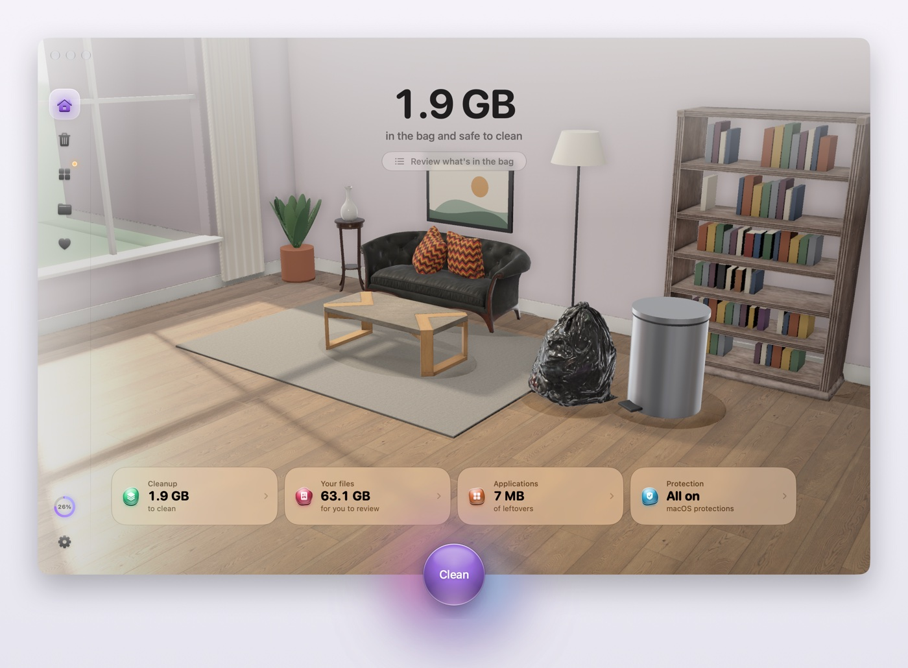
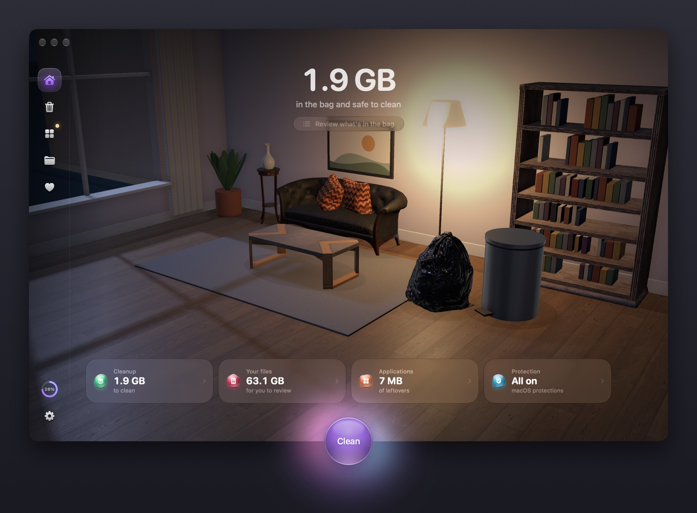
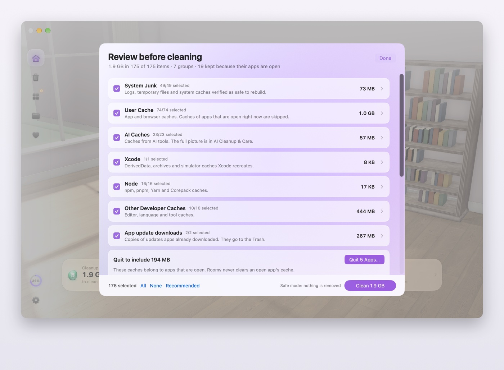
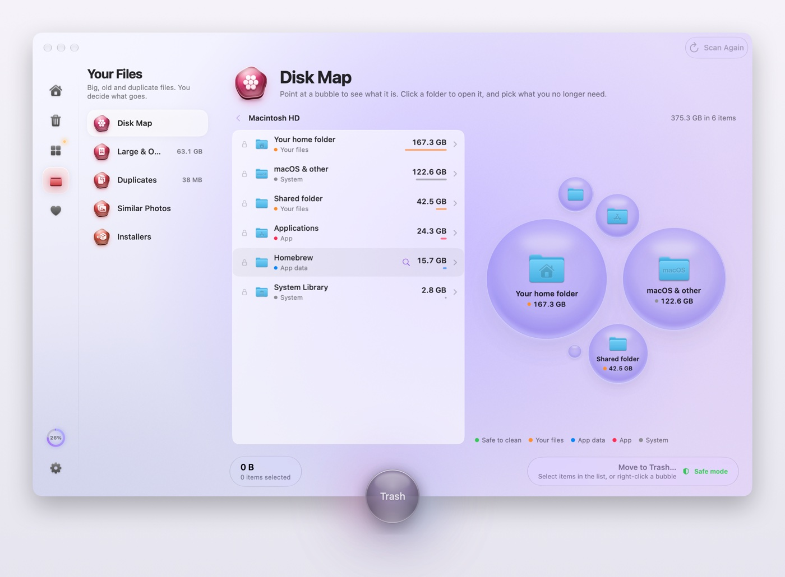
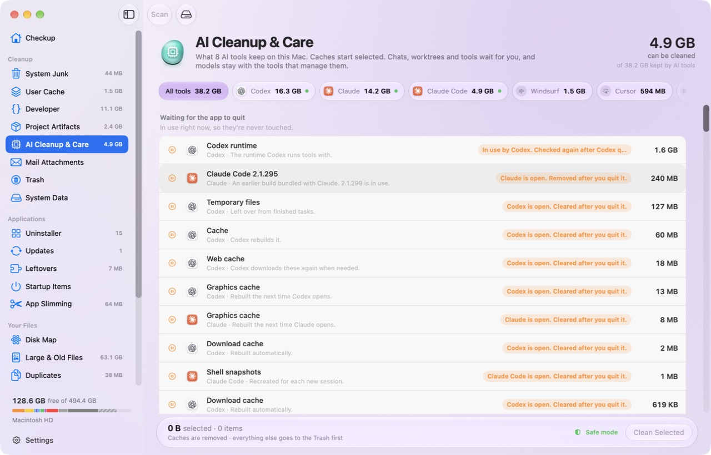
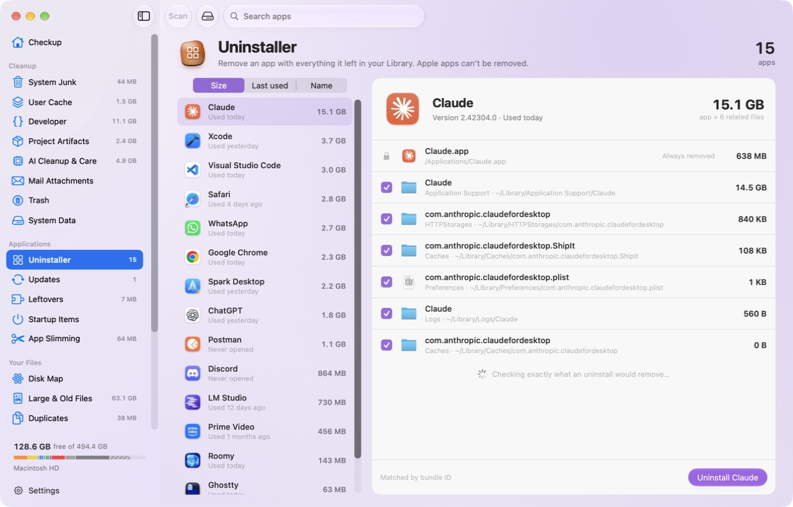
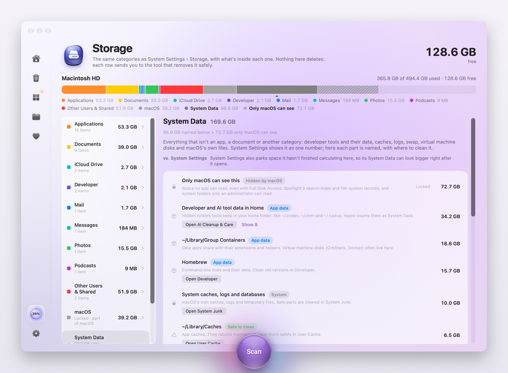
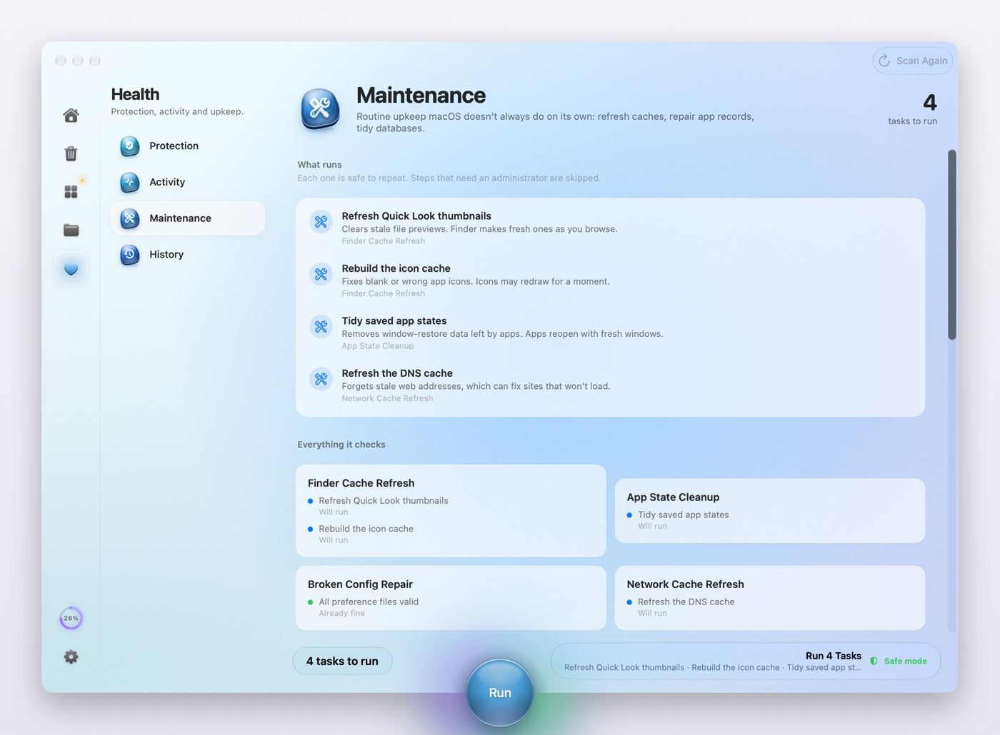
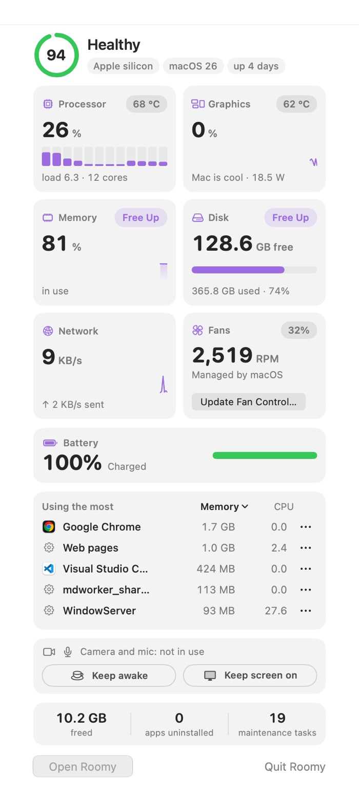

<p align="center">
  
</p>

<p align="center">
  
</p>

<h1 align="center">Roomy</h1>

<p align="center">
  <b>Make room on your Mac, and see exactly what goes before it goes.</b><br>
  A free, open-source Mac cleaner and activity monitor, native to macOS 26. No subscription, no account, no telemetry.
</p>

<p align="center">
  <a href="https://github.com/dibyajyotiron/roomy/releases/latest"></a>
  
  
  
  
  <a href="LICENSE"></a>
  <a href="https://github.com/dibyajyotiron/roomy/releases"></a>
</p>

<p align="center">
  <a href="#install">Install</a> -
  <a href="#why-roomy">Why Roomy</a> -
  <a href="#how-it-compares">How it compares</a> -
  <a href="#our-promise">Our promise</a> -
  <a href="#what-it-does">What it does</a> -
  <a href="#permissions">Permissions</a> -
  <a href="#build-from-source">Build from source</a>
</p>

---

## Install

Paste this into Terminal:

```bash
curl -fsSL https://raw.githubusercontent.com/dibyajyotiron/roomy/main/scripts/install.sh | sh
```

It installs the latest Roomy in your Applications folder and opens it. It downloads the release, checks the release's signature (made with Roomy's own release key) and the archive's digest, quits Roomy if it's already running, and leaves the app owned by you so updates never need a password. It asks for your password only if your account can't write to Applications. Mole, the engine Roomy cleans with, comes inside Roomy, so there's nothing else to install. Piping a script into `sh` runs it as you, so [read it first](scripts/install.sh) if you like; it's short and plain. Checking the signature needs Apple's Command Line Tools; without them the script says how to get them (`xcode-select --install`) and installs nothing.

**Signed, notarized download: coming soon.** Until then, a `.pkg` downloaded from [Releases](https://github.com/dibyajyotiron/roomy/releases/latest) in a browser is blocked by macOS the first time. To open it anyway: click **Done**, then go to **System Settings › Privacy & Security**, scroll down and click **Open Anyway**, enter your password and click **Open**. (Right-click › Open no longer works for this on macOS 15 and later.) The Terminal install above doesn't need any of that.

**Updates.** When there's a new version, an **Update** button appears in the toolbar (Roomy checks every 10 minutes, and Settings has **Check Now**). Click it: Roomy downloads the update, quits, installs it and reopens. Nothing downloads until you click. Updates are signed, and Roomy installs only ones signed with its own key.

**First run.** Roomy asks for **Full Disk Access** so a scan can see caches in every folder without a question per folder (see [Permissions](#permissions)). **Safe mode** is on until you turn it off in Settings: every clean shows what it would remove and removes nothing.

Requirements: macOS 26 or later on Apple silicon.

## Why Roomy

Most Mac cleaners ask you to trust a big number. Roomy shows you the list.

- **You see what Mole found before you clean.** One review lists Mole's findings, grouped like the cleanup screens, each with its size and where it lives. Clean then runs Mole's own clean, which checks everything again at that moment, so the result can differ a little from the preview.
- **Careful by default.** Cleaning runs on [Mole](https://github.com/tw93/mole)'s open-source engine and its protection rules. Caches of apps that are open are skipped. Nothing that belongs to macOS, another account or a running container is ever offered. A clean never runs on a scan that's more than an hour old.
- **Honest numbers.** "Freed" means freed. A folder and something inside it are counted once. Anything moved to the Trash is called out as such, and History records every removal, file by file.
- **Knows what developers and AI tools leave behind.** Xcode, Homebrew, npm, pnpm, Docker build cache (never volumes), project build folders, and the caches, old versions and chats of Claude, Codex, Cursor, LM Studio, Ollama and more.
- **A real Activity Monitor.** CPU, memory, energy, disk, network and temperatures, measured the way Activity Monitor measures them, plus fan control.

## How it compares

| | Roomy | CleanMyMac | Mole |
|---|---|---|---|
| Price | Free | Paid subscription | Free |
| Source code | Open, GPL-3.0 | Closed | Open, GPL-3.0 |
| What it is | Native macOS 26 app | Native app | Command line, plus a desktop app |
| Signed and notarized by Apple | Coming soon (install from Terminal for no extra clicks) | Yes | Installs with Homebrew |
| Review before removing | Mole's findings listed and grouped, with sizes and Show in Finder | — | Text preview (`--dry-run`) |
| Your Trash during a clean | Never emptied; only when you empty it yourself | — | Emptied by default |
| After a clean | What was freed, what went to the Trash, and every removed file in History | — | Session log |
| AI tools | Caches, old versions, chats and worktrees of Claude, Codex, Cursor, LM Studio, Ollama and more | — | Caches of common AI apps |
| Docker | Build cache only; images, containers and volumes are never touched | — | Build cache |
| Activity monitor | CPU, memory pressure, energy, disk, network, temperatures, fan control | Menu bar monitor | Live status dashboard |
| Cleaning engine | Mole's, pinned to the version each Roomy release is tested with, plus Roomy's guardrails | Its own | — |

<sub>From each project's own website and README, October 2026. "—" means we couldn't confirm it from public information, not that it's missing. CleanMyMac is a trademark of MacPaw; Roomy isn't affiliated with any of these projects.</sub>

## Our promise

A Mac cleaner asks for Full Disk Access and then deletes files. Here's what Roomy holds itself to, and you can check every line in the source:

- **You see it before it goes.** Checkup shows Mole's findings first; Clean runs Mole's own clean, which re-checks every item at that moment. Everywhere else (AI Cleanup, Leftovers, your files) only what you select is removed, and each item is checked again just before.
- **Your Trash is your undo.** Roomy never empties it. Your own files (Disk Map, large files, duplicates) are never selected for you and always go to the Trash.
- **Off limits, always:** your home folder, Library roots, iCloud Drive, other accounts, Docker volumes, containers and images, OrbStack data, and worktrees with uncommitted changes. Mole's keep list (Spotlight, fonts, iCloud Drive, model downloads) applies at the moment of removal.
- **Leftovers are careful.** They start selected only when they're caches, logs, saved window state or web storage of an app that's gone and hasn't been touched for 30 days.
- **The engine doesn't change under you.** Roomy uses the Mole bundled inside it, the version that release was tested with. A newer Mole arrives only in a new Roomy release.
- **No telemetry, no account, no subscription.** The only network calls are update checks to this repository's releases. Nothing about your Mac leaves it.
- **One clean at a time,** and every removal is logged in History.

## What it does

| | |
|---|---|
| **Checkup** | One scan for junk, caches, developer and AI leftovers, large files and your Mac's health. A real-time 3D living room shows each piece of clutter picked up and thrown into one bag, your books put back on the shelf, and the bag binned when you clean. One round button at the bottom of the window scans, then cleans, on every screen. |
| **Review before cleaning** | Mole's findings grouped like the cleanup screens, with counts, sizes and Show in Finder. |
| **Cleanup** | System junk, user caches, developer tools, project build folders, AI tools, Mail attachments, Trash, and the parts of System Data. |
| **Applications** | An uninstaller that finds an app's leftovers, Homebrew app updates, startup items listed the way System Settings lists them (with what's really on, what's broken, and what was switched off behind its back), and app slimming (listed for review; Roomy never edits inside an app). **Leftovers** of apps you delete any other way (to the Trash, with an uninstaller or Homebrew) are found the moment the app goes, from its name and bundle ID, with a notification saying how much it left. |
| **Your Files** | Disk Map (your disk as Liquid Glass bubbles you can explore and throw around), large and old files, duplicates, similar photos, old installers. |
| **Activity** | Live CPU, memory pressure, energy, disk, network and thermals; a sortable process list with Quit and Force Quit; fan presets. |
| **Menu bar** | Health, live tiles with **Free Up** for memory and disk, battery health with its cycle count and use since the last full charge, the busiest apps, camera and mic status, Keep awake and Keep screen on, and what Roomy has freed so far. |
| **Storage** | The same categories as System Settings › Storage, with what's inside each and where to clean it. Free space is what's truly free, the same number `df` and Mole show. |
| **Protection** | Gatekeeper, FileVault, Firewall, SIP and XProtect at a glance, with a direct link to fix anything that's off. |
| **Maintenance** | Mole's own `mo optimize`, with Mole's defaults, listing each task in plain words before it runs. |

<p align="center">
  
  
</p>
<p align="center">
  
  
</p>
<p align="center">
  
  
</p>
<p align="center">
  
</p>

<sub>Screenshots come from Roomy's demo build (`Roomy/build.sh --demo`), which shows a sanitised sample instead of anyone's files and never removes anything.</sub>

## Permissions

- **Full Disk Access** lets a scan read caches and app data in every folder, including Mail and other apps' containers, without macOS asking about each folder. Scans only read. Without it, Roomy still works but can't measure Mail attachments, the Trash or some app data, and says so. Roomy's free signing ties the permission to each exact build, so another app can't borrow it; the cost is that macOS may ask you to grant it again after a Roomy update.
- **Administrator password**: never asked for by a scan or a clean. Roomy cleans what your account can clean and leaves system-level items that would need an administrator alone. Only fan control and freeing memory ask, through macOS's own password prompt, when you choose them.
- **Notifications**: asked once, the first time an app you remove leaves files behind, so Roomy can tell you how much.
- **Network**: update checks to this repository's GitHub releases, and Homebrew's own servers when you update an app with it. Nothing else.

## Build from source

```bash
brew install mole xcodegen      # Mole is copied into the app at build time
git clone https://github.com/dibyajyotiron/roomy.git && cd roomy
Roomy/build.sh --install        # builds, installs to ~/Applications and opens it
```

Open `Roomy.xcworkspace` in Xcode 26 to work on it there.

## Releasing

1. Once per maintainer: `Vendor/Sparkle/bin/generate_keys --account roomy` makes the update signing key. The private key stays in your login Keychain and never goes in this repository. Put the printed public key in `Roomy/Resources/sparkle-public-ed-key.txt`, and keep a backup of the private key somewhere safe (`generate_keys --account roomy -x <file>`): without it you can't ship updates to existing installs.
2. Set the version in `VERSION`. `MOLE_VERSION` is the Mole the release ships; to move to a newer Mole, install it (`brew upgrade mole`), test Roomy with it, then change `MOLE_VERSION`.
3. Run `Roomy/release.sh`. It refuses to build if the bundled Mole isn't `MOLE_VERSION` or fails Roomy's checks, then makes `dist/Roomy-<version>.pkg`, `.zip` (the update, signed with your key), `appcast.xml` (the feed every Roomy checks) and `.sha256`.
4. Commit, push to `main` and wait for the **Build** check to pass on GitHub. Then run `scripts/publish-release.sh`. It publishes only when `dist/` was built from that exact commit with no local changes and CI passed for it. A release published any other way on a commit whose build didn't pass is turned back into a draft by the Release guard workflow, so it never reaches anyone.

Roomy checks `releases/latest/download/appcast.xml`, so publishing a release is what makes it reach everyone. With an Apple Developer ID, set `ROOMY_SIGN_IDENTITY`, `ROOMY_INSTALLER_IDENTITY` and `ROOMY_NOTARY_PROFILE` and the release script signs and notarizes too.

## Contributing and security

Pull requests are welcome. Only the maintainer can merge, `main` and release tags are protected, and every pull request needs a passing build and the maintainer's review. Workflows from outside contributors run only after the maintainer approves them. To report a security problem privately, see [SECURITY.md](SECURITY.md).

## Credits and license

Roomy is free software under the [GNU General Public License v3.0](LICENSE).

- [Mole](https://github.com/tw93/mole) by tw93 and contributors (GPL-3.0): the cleaning engine, bundled inside Roomy and ported in part to Swift in `Packages/MoleCore`.
- [Stats](https://github.com/exelban/stats) by Serhiy Mytrovtsiy (MIT): the SMC code behind fans and temperatures.
- [Sparkle](https://sparkle-project.org) (MIT) for Roomy's own updates.
- [Pow](https://github.com/EmergeTools/Pow) (MIT) for effects, and CC0 scans from [Poly Haven](https://polyhaven.com) for the living room.

Full notices are in [NOTICE.md](NOTICE.md) and `LICENSES/`. Roomy isn't affiliated with Apple, MacPaw, Mole or any other cleaner.
